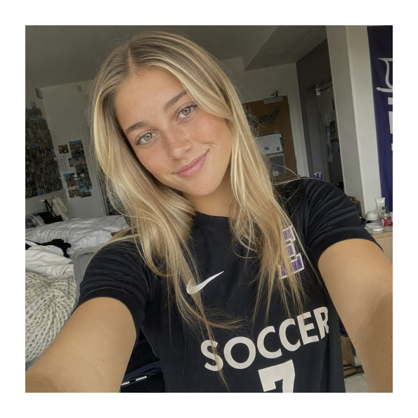
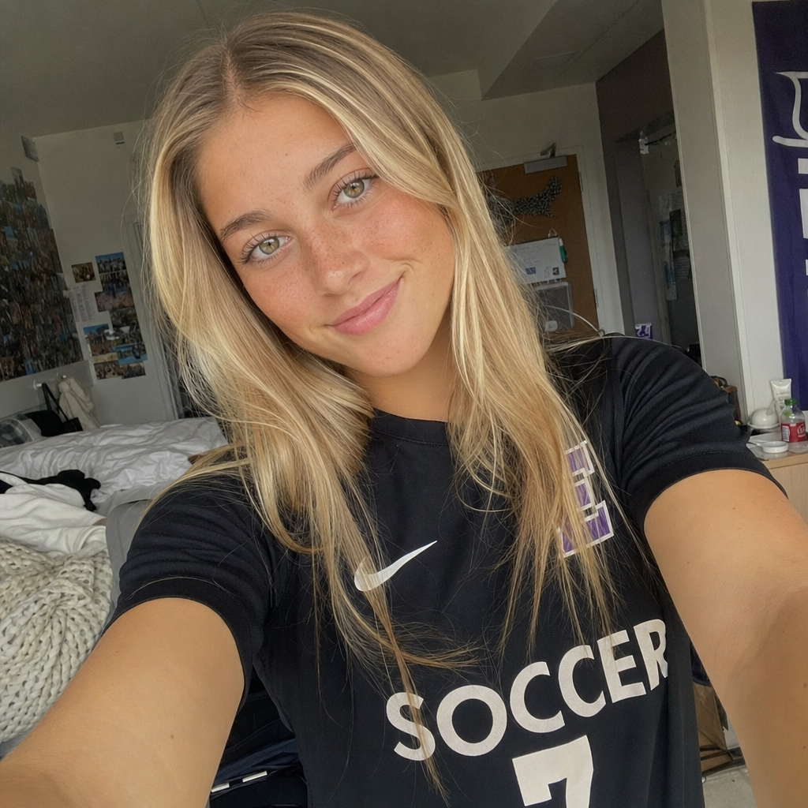

# Week 3 – Make 1: Selfie & Identity

## The Artifact

For this week's Critical Make on **Selfie & Identity**, I explored how generative AI interprets, modifies, and co-constructs facial identity from a personal photographic reference.

  

    
    
Figure 1: 1st AI Co-Constructed Portrait

    
Generated using text prompt specifying age, sport, eye color, hair, and facial features.

  

  

    
    
Figure 2: Edited AI Co-Constructed Portrait

    
Refined iteration adjusting freckles, face shape, lips, eye hue, eyebrows, and lashes.

  

## Process Notes

1. **1st AI Co-Constructed Portrait (Figure 1)**:
   - **Generation Prompt:**
     > *"selfie of a 19 year old girl who is 125lbs and plays soccer at a D3 school has green/hazel eyes, blonde hair, blonde highlists, not much of a shape with eyebrows, a nose that fits her face size wise and is straight. with freckles on it"*
   - Explored how descriptive tokens (age, collegiate sport division, hair color/highlights, eye color, eyebrow shape, nose proportions, and freckles) are synthesized into a cohesive visual representation of identity.
2. **Edited AI Co-Constructed Portrait (Figure 2)**:
   - **Iterative Edit Prompt:**
     > *"make the freckles less prominent, a bit more of a round/oval shaped face, thinner lips and more greenish/blueish eyes,a bit bigger eyebrows, shorter eyelashes"*
   - Applied targeted prompt corrections to steer the representation closer to authentic self-perception: softening freckle prominence, subtly rounding facial contours into an oval silhouette, adjusting lip thickness, shifting eye pigmentation to greenish/blueish, filling out eyebrows, and moderating eyelash length.
3. **Critical Observations**:
   - Examining the progression between the first generation and the edited version illustrates how user direction negotiates with algorithmic defaults to shape identity representation.

## Reflection

> **Reflect 3:** *What does “authenticity” mean when identity is co-constructed with AI?*

When identity is being co-constructed with AI, the authenticity is not the same as just coming from yourself. When you are being authentic you are being true to yourself, and is coming from you. When AI is used to help portray your identity, you have to give the AI direction on what to know about your identity. This is where AI takes away the authenticity, because AI will create assumptions within where you may not be as specific. You are the one who can input the information you want AI to show your identity as, which can leave gaps for the AI to make assumptions. Although that doesn't mean you should tell AI to create a version of your identity you want to be perceived as, and not your true identity.

## Attribution & AI Use

- **Tools Deployed:** Generative AI Image Synthesis / Image-to-Image Diffusion.
- **AI Prompt (Figure 1 – Initial Generation):** `selfie of a 19 year old girl who is 125lbs and plays soccer at a D3 school has green/hazel eyes, blonde hair, blonde highlists, not much of a shape with eyebrows, a nose that fits her face size wise and is straight. with freckles on it`
- **AI Prompt (Figure 2 – Iterative Edit):** `make the freckles less prominent, a bit more of a round/oval shaped face, thinner lips and more greenish/blueish eyes,a bit bigger eyebrows, shorter eyelashes`
- **What the Model Generated:** Initial synthetic portrait followed by re-rendered facial geometry, softened freckle distribution, adjusted eye hue, and revised eyebrow/lash morphology.
- **Human Authorship & Critical Decision:** Formulating the initial descriptive attributes, identifying discrepancies between algorithmic assumptions and personal identity, and steering iterative prompt refinements toward authentic representation.
