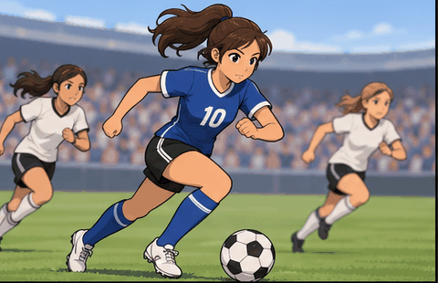

# Week 5 – Make 3: GIF & Remix Culture

## The Artifact

For this week's Critical Make on **GIF & Remix Culture**, I created and remixed an animated micro-loop exploring athletic motion, visual stylization, and repetition.

  
  
Figure 1: Animated Soccer Sprint Loop

  
A dynamic micro-animation loop translating athletic momentum and soccer gameplay into stylized animation.

## Process Notes

1. **Concept & Visual Theme**:
   - Building upon my personal athletic background as a collegiate soccer player (explored in Week 3's Identity Make), I chose to translate the fast-paced energy of a match into a looping animated GIF.
2. **Animation Mechanics & Loop Design**:
   - Focused on the rhythm of the sprint cycle, the cadence of the ball dribble, and the parallax motion of teammates tracking back in the stadium environment.
   - Tuned the loop transition so the running cycle seamlessly cycles without jarring frame breaks.
3. **Remix & Cultural Context**:
   - The GIF format occupies a unique position in digital culture—straddling the boundary between cinema, meme culture, and vernacular web art.

## Reflection

> **Reflect 5:** *How does AI alter authorship and remix culture? Who owns AI-made art?*

*(Add your reflection response to this prompt here or in reflections/week05.md)*

## Attribution & AI Use

- **Tools Deployed:** Animation synthesis & digital media GIF loop creation.
- **Media Asset:** `assets/images/download.gif` (480x310 animated GIF).
- **Creative Direction:** Athletic soccer sprint theme, character design, and looping tempo.
